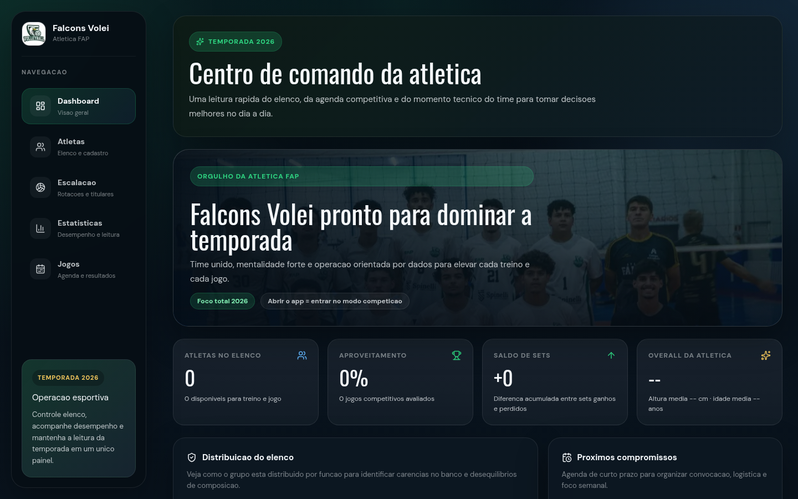

# Feature Spec - Arquitetura Padrao (Falcons Volei)

Documento normativo do sistema de gestao do time de volei Falcons: cadastro de atletas, escalacao, jogos e estatisticas.



## Escopo

Define a stack, a estrutura de pastas, o fluxo de dependencia e as regras de composicao da UI e da API. Toda nova tela, recurso ou rota deve seguir este spec. Regras de protecao de dados ficam em [feature.security.md](feature.security.md) e sao obrigatorias.

## Dominio

| Area | Rota | Tabela Supabase | Dado sensivel |
| --- | --- | --- | --- |
| Dashboard | `/dashboard` | todas (leitura) | sim |
| Atletas | `/players` | `jogadores_leilao` | CPF, telefone, data de nascimento, peso, altura |
| Escalacao | `/lineup` | `jogadores_leilao` (leitura) | sim |
| Jogos | `/games` | `jogos` | nao |
| Estatisticas | `/statistics` | `estatisticas_individuais` | desempenho individual |

## Stack obrigatoria

- Next.js 16 com App Router (rotas e API no mesmo repositorio)
- React 19
- TypeScript
- Tailwind CSS 4
- Supabase (Postgres, Auth e Storage)
- ESLint

## Requisitos obrigatorios

1. Pastas obrigatorias

- src/app (rotas e `api/`), src/components (layout, sections, ui), src/lib, src/proxy.ts e public (na raiz).
- src/content e src/types entram quando uma secao tiver texto ou tipo proprio.

2. Separacao de responsabilidade

- src/app: rotas, layout, metadata e busca de dados no servidor
- src/app/api: unica porta de escrita no banco (POST, PATCH, DELETE)
- src/components/sections: markup de cada tela (dashboard, players, games, lineup, statistics, login)
- src/components/ui: elementos visuais genericos, sem texto de negocio
- src/components/layout: sidebar e top-bar
- src/lib: helpers (`utils.ts`), regras de volei (`volleyball.ts`), API (`api.ts`, `api-client.ts`) e Supabase (`supabase/`)
- src/proxy.ts: sessao, redirecionamento para login e headers de seguranca

3. Fluxo de dependencia (sempre nessa direcao)

- src/app (pages) -> src/components/sections -> src/components/ui
- src/components/sections -> src/lib
- src/app/api -> src/lib (api.ts, supabase/server.ts)
- src/components (client) -> src/lib/api-client.ts -> /api (nunca o Supabase direto)

4. Regra da page

- `page.tsx` busca dados no servidor e entrega por props a uma secao
- sem markup de secao, sem estilo e sem regra de negocio

5. Regra da secao

- recebe dados por props
- nao importa outra secao
- Server Component por padrao; "use client" so com estado, evento ou efeito

6. Regra da API

- toda rota de escrita chama `authorize()` (origem + sessao) antes de qualquer acesso ao banco
- tabelas e colunas aceitas ficam em `resources` (`src/lib/api.ts`); campo fora da lista e descartado
- erros devolvem mensagem generica; o detalhe vai para o log do servidor

7. Regra do Tailwind

- estilo apenas por classes utilitarias ou classes do design do painel em `globals.css`
- cores, fontes e espacamentos como tokens
- mobile first: base sem prefixo, depois sm:, md:, lg:

8. Convencoes de arquivo

- arquivos em kebab-case (players.tsx, top-bar.tsx)
- componentes em PascalCase
- tabelas e colunas do banco em snake_case, como ja existem

## Estrutura obrigatoria de arquivos

```text
src/proxy.ts
src/app/layout.tsx
src/app/page.tsx
src/app/globals.css
src/app/login/page.tsx
src/app/<rota>/page.tsx
src/app/api/[resource]/route.ts
src/app/api/[resource]/[id]/route.ts
src/app/api/photos/route.ts
src/app/api/auth/{login,logout}/route.ts
src/components/layout/{sidebar,top-bar}.tsx
src/components/sections/<secao>/<secao>.tsx
src/lib/{api,api-client,utils,volleyball}.ts
src/lib/supabase/{server,middleware}.ts
supabase/migrations/*.sql
public/...
```

## Criterios de aceitacao

- Estrutura obrigatoria respeitada
- Page apenas busca dados e compoe a secao
- Nenhum componente importa o cliente Supabase de browser
- Toda escrita passa por `/api` com sessao valida
- Toda tabela nova nasce com RLS ligado (ver feature.security.md)
- Responsivo e acessivel
- Sem imports ciclicos
- npm run lint e npm run build sem erros

## Nao permitido

- Chamar o Supabase direto do navegador
- Policy de RLS com `TO anon` ou sem `TO authenticated`
- Segredo, chave `service_role` ou dado de atleta em codigo, log ou `NEXT_PUBLIC_*`
- Aceitar o corpo da requisicao inteiro sem passar por `pickFields`
- Importar uma secao dentro de outra
- "use client" na secao inteira sem necessidade
- Tag img em vez de next/image em codigo novo

## Processo de evolucao

1. Criar a migration da tabela (com RLS) em supabase/migrations
2. Registrar o recurso e as colunas permitidas em `resources` (src/lib/api.ts)
3. Criar a secao em src/components/sections/<secao> e a rota em src/app/<rota>
4. Adicionar o link na sidebar
5. Validar responsivo, lint, build e o checklist de seguranca
